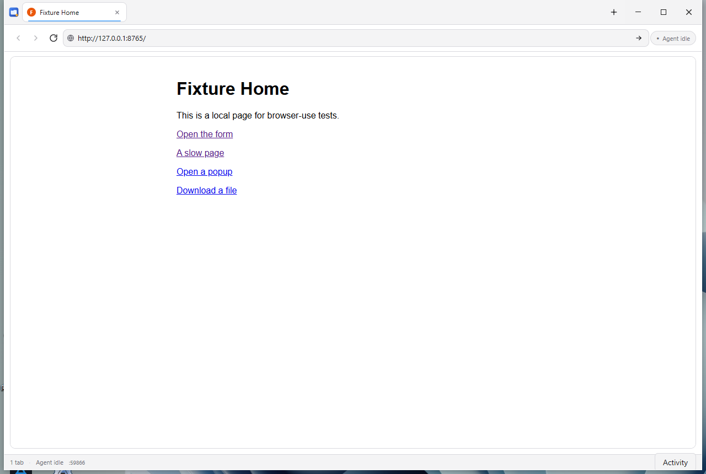
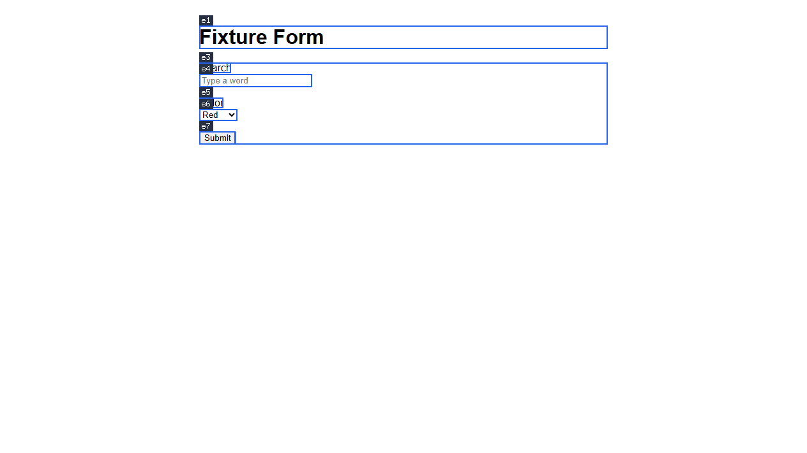
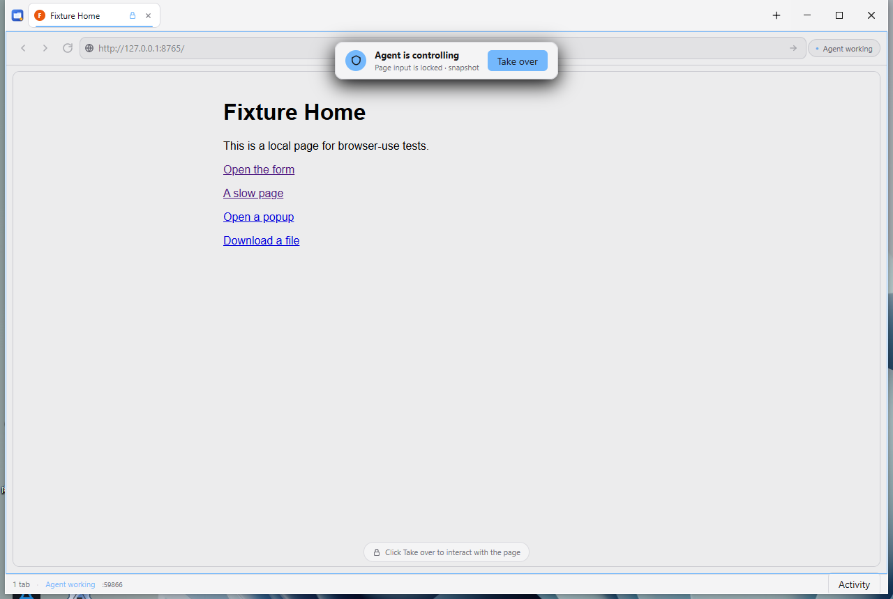
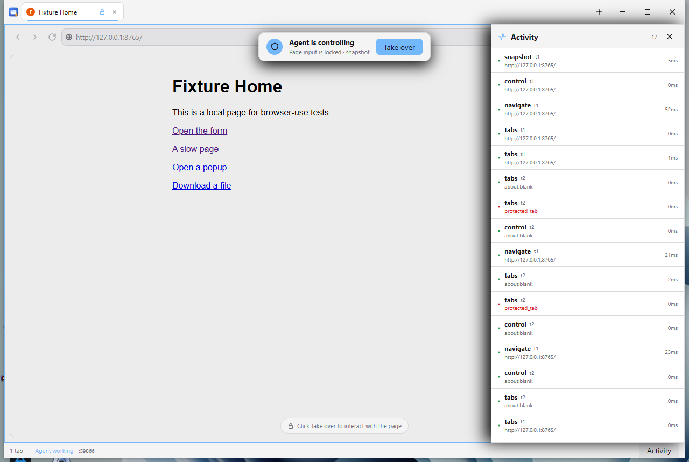

# browser-use

A desktop browser for AI agents, built on [mygo](https://github.com/egoist/mygo):
native tabs, one embedded web view per tab, a token-guarded local API / CLI,
and a moejs JavaScript/TypeScript script engine.

**Status: M1 + M1.5** — tabs, snapshots with refs, click/type/press/select/
scroll/hover/read/eval/navigate/wait, annotated screenshots, downloads,
intercepted dialogs, console capture, audit log + activity panel, the agent
mask with `Take over`, and `browser-use run flow.ts` on moejs.



## Build and run

Requires Go 1.27.3+ (`github.com/egoist/mygo v0.7.4` is a normal module
dependency; no replace directive is needed). Inside the ada-go repo the parent
`go.work` does not list this module, so build with `GOWORK=off`. From the repo
root the unified MCP build script writes the binary to the path the ada-go
`browser-use` plugin auto-discovers:

```powershell
.\scripts\build-mcp.cmd          # also builds computer-use
# or only this module:
cd mcp_projects\browser_use
$env:GOWORK = "off"
go build -trimpath -ldflags "-H windowsgui" -o bin\browser-use.exe .
.\bin\browser-use.exe --url https://example.com
```

`mcp_projects/browser_use/bin/browser-use.exe` is what the official
`browser-use` plugin uses when `BROWSER_USE_EXE` is not set.

The fixture pages used in development live in `testdata/site`:
`node testdata/site/server.mjs 8765`.

The API listens on `127.0.0.1` on an ephemeral port and writes its token and
port to `%APPDATA%\browser-use\runtime.json`. The CLI starts the app when it is
not running.

```sh
.\bin\browser-use.exe cli status
.\bin\browser-use.exe cli tabs list
.\bin\browser-use.exe cli navigate --tab t1 https://example.com
.\bin\browser-use.exe cli snapshot --tab t1
.\bin\browser-use.exe cli click --tab t1 --ref e12
.\bin\browser-use.exe cli type --tab t1 --ref e11 --text "hello" --submit
.\bin\browser-use.exe cli wait --tab t1 --for selector --value "text=Done"
.\bin\browser-use.exe cli wait --tab t1 --for time --value 1500   # milliseconds
.\bin\browser-use.exe cli read --tab t1
.\bin\browser-use.exe cli screenshot --tab t1 --annotate --out shot.png
.\bin\browser-use.exe cli scroll --tab t1 --direction down --amount 600
.\bin\browser-use.exe cli hover --tab t1 --selector "#submit"
.\bin\browser-use.exe cli eval --tab t1 --expr "document.title"
.\bin\browser-use.exe cli downloads
.\bin\browser-use.exe cli dialogs --tab t1
.\bin\browser-use.exe cli control release
```

An annotated screenshot (refs drawn over the page):



## Scripts (moejs)

`script` is a single tool that runs a JS/TS async function body against the
same browser API, so a multi-step flow is one call. `browser-use run` reads a
file (or `-e`) and prints the JSON result, console output and action list.

```js
const page = await browser.active();
await page.goto("https://news.ycombinator.com");
const snap = await page.snapshot();
const search = snap.match(/\[(e\d+)\] textbox "Search"/)?.[1];
await page.fill(search, args.q, { submit: true });
await page.waitForURL("/from");
return await page.evaluate(() =>
  [...document.querySelectorAll("tr.athing")].slice(0, 5).map((tr) => ({
    title: tr.querySelector(".titleline")?.textContent?.trim(),
    href: tr.querySelector("a")?.href,
  }))
);
```

```sh
.\bin\browser-use.exe run --args '{"q":"webview"}' flow.ts
.\bin\browser-use.exe run -e 'const p = await browser.active(); return await p.title()'
```

Flags go before the script file (Go's `flag` stops at the first positional).

The prelude provides `browser.tabs/newPage/active/page/release/call/status/
downloads` and `Page.goto/back/forward/reload/stop/snapshot/snapshotRaw/read/
click/dblclick/fill/type/press/select/hover/scroll/waitForSelector/waitForURL/
waitForText/waitForLoad/waitForDownload/evaluate/screenshot/dialogs/requests/
request/clearRequests/waitForRequest/cookies/upload/frames/useFrame/mainFrame/
info/url/title/activate/close`, plus `console.*` and `sleep(ms)`.

Limits: 120 s default / 300 s max, 64 MiB JS heap, 200 tool calls, 32 KiB
console, 64 KiB result, 256 KiB source, one script at a time. Scripts have no
`fetch`, `fs`, `eval`, `Function` or `import`; every action still goes through
URL policy, approvals, the mask and the audit log. Sources are kept under
`%APPDATA%\browser-use\scripts\<date>\` (config `script.keep_sources`).

Flags come before positional arguments (for example
`navigate --tab t1 https://example.com`).

## Network capture

The runtime preload wraps `fetch` and `XMLHttpRequest` **before page scripts**,
so SPA login, menu and query APIs are captured without CDP. Each entry has
method, URL, status, timing, headers and request/response bodies (bodies are
capped at 16 KiB request / 128 KiB response, 300 entries / 4 MiB total).
`password`, `token`, `secret`, `cookie` and `session` fields/headers are
redacted. `network wait` arms after the current last request, so it can be
paired with a click to avoid polling races.

```sh
.\bin\browser-use.exe cli network list --tab t1 --url-contains /api/ --limit 20
.\bin\browser-use.exe cli network get --id n16 --max-body 20000
.\bin\browser-use.exe cli network wait --url-contains /mySchedule --timeout 5000
.\bin\browser-use.exe cli network clear
```

```js
const page = await browser.active();
const recent = await page.requests({
  url_contains: "/scheduleStat/mySchedule",
  include_body: true,
  limit: 5,
});
const entry = recent.entries[recent.entries.length - 1];
const body = JSON.parse(entry.res_body);
return body.data.summary;

// Or wait for the request a click is about to trigger:
// await page.waitForRequest({ url_contains: "/mySchedule", timeout_ms: 5000 });
```

Capture is per document: a full navigation starts a fresh log; hash routes keep
it. The document request itself, WebSocket frames and SSE/event-stream bodies
are not captured. `network` is a read tool, but it still goes through the lease,
mask, URL policy and audit log.

Example from the test site: `n16` is
`POST /api/wit-hosp-schedule-service/scheduleStat/mySchedule`; its request body
is `{"loginName":…,"startDate":"2026-11-01","endDate":"2026-11-30"}` and the
response contains `summary` plus 19 shift days.

## Console capture

The same preload wraps `console.log/info/warn/error/debug` **before page
scripts**, and records uncaught exceptions (`error` event) and unhandled
promise rejections. `console list/get/clear/wait` read that buffer: every line
keeps its id, timestamp, level, text, source (`console`/`exception`/
`rejection`), document URL and source position.

Buffers are per document: a full navigation starts empty, hash routes keep the
log. Limits are 500 lines / 512 KiB total / 8 KiB per line (truncation is
flagged). `token`, `secret`, `password`, `cookie` and `session` fields inside
logged objects, plus `?token=`-style query strings, are redacted.

`console wait` arms after the current last line, so it can be paired with a
click to catch the error that click triggers. The wait lives in the page (one
pending promise, no polling), so page timers, user clicks and other in-page
events still log while it waits; the tab's action slot is busy for the
duration, so trigger the action first and wait after it. A timeout is a normal
empty result (`matched: false`), not an error.

```sh
.\bin\browser-use.exe cli console list --level error --limit 20
.\bin\browser-use.exe cli console list --contains Uncaught --source exception
.\bin\browser-use.exe cli console wait --contains /api/ --timeout 5000
.\bin\browser-use.exe cli console get --id c12
.\bin\browser-use.exe cli console clear
```

This is the *page* console; `console.log` inside a `script` is the script
engine's own console and comes back in the script result's `console` array.

## Long calls (async API)

`/v1/call` is synchronous: response headers are only written when the tool
finishes. Any client that caps time-to-first-byte — ada-go's host bridge uses
15 s, nginx `proxy_read_timeout`, `curl --max-time`, … — will abort long scripts
and waits; worse, the server then records the script as `script_timeout`, which
misattributes a *client* timeout to the script engine.

`/v1/calls` decouples the task from the request:

```sh
# start: returns immediately with {ok,id,status:"running",timeout_ms}
curl -s -X POST -H "Authorization: Bearer $TOKEN" -H "Content-Type: application/json" \
  -d '{"name":"script","args":{"source":"await sleep(30000)"},"timeout_ms":40000}' \
  http://127.0.0.1:$PORT/v1/calls

# poll: {ok,job:{id,name,status,started_at,ended_at,elapsed_ms,result}}
curl -s -H "Authorization: Bearer $TOKEN" http://127.0.0.1:$PORT/v1/calls/$JOB

# cancel
curl -s -X DELETE -H "Authorization: Bearer $TOKEN" http://127.0.0.1:$PORT/v1/calls/$JOB
```

- `status` is `running` | `done` | `cancelled`; `result` is the same envelope as
  `/v1/call` (`ok/data/tab/error/timing_ms`).
- The task is **not** tied to the request: if the caller disconnects or times
  out, the task keeps running and the result can still be polled.
- `X-Client-Id` is kept for the whole task, so leases and the audit log still
  point at the caller (not at `http`/`cli-<pid>`).
- Limits: 4 concurrent tasks (429 beyond), 64 retained, finished tasks are
  cleaned up after 10 minutes.

The CLI also accepts a global `--client <id>` (`--client=<id>` works too) for
`cli ...` and `run ...`; without it the client id is `cli-<pid>`, and leases and
audit entries cannot be attributed to the caller.

## MCP

The tray menu's **Copy MCP Config** copies this stdio entry for ada-go's
`.adago/mcp.json` `servers` array (the command is the running executable):

```json
{
  "id": "browser_use",
  "transport": "stdio",
  "command": "C:\\path\\to\\browser-use.exe",
  "args": ["mcp"]
}
```

`browser-use mcp` reuses the running app through `runtime.json` and speaks MCP
on stdin/stdout. HTTP mode is a separate process
(`browser-use mcp --http --port 8766`) serving `/mcp`; do not point the client
at the app's control port — that API requires the runtime bearer token and is
not MCP (a 401 "missing or wrong token" means the client hit the control API).

`browser-use mcp` is a stdio MCP server. `initialize`, `tools/list` and
`tools/call` are implemented; tool schemas come from the same
`internal/control` registry as `/v1/tools`, so there is one source of truth.

```json
{
  "mcpServers": {
    "browser-use": {
      "command": "E:\\codes\\go_projects\\ada_go\\mcp_projects\\browser_use\\bin\\browser-use.exe",
      "args": ["mcp"]
    }
  }
}
```

- `tools/list` works without starting the GUI.
- The first `tools/call` starts the app through the loopback API if needed.
- `screenshot` is forced to `inline` and returned as MCP `image` content,
  plus `structuredContent` with path/size/ref count.
- `script`, `network` and every other tool are available.
- On stdin EOF the stdio server cancels in-flight calls and releases agent
  leases; the app stays open.
- `notifications/cancelled` cancels a running call by request id.

Streamable HTTP:

```sh
browser-use mcp --http --port 8766
```

```json
{
  "mcpServers": {
    "browser-use": {
      "url": "http://127.0.0.1:8766/mcp"
    }
  }
}
```

`POST /mcp` handles JSON-RPC; `GET /mcp` with `Accept: text/event-stream`
opens a keepalive stream; `DELETE /mcp` releases this client's leases. The
transport is stateless and bound to loopback.

## Cookies, files and frames

```powershell
browser-use cli cookies list --url http://127.0.0.1:8080/
browser-use cli cookies set --name session --value TOKEN --domain 127.0.0.1 --path /
browser-use cli cookies delete --name session --domain 127.0.0.1 --path /
browser-use cli cookies import --file cookies.json
browser-use cli files upload --selector '#upload' --path report.pdf
browser-use cli frames list
browser-use cli frames use --frame f2
browser-use cli frames main
```

- `cookies` reads/writes the agent session's cookies, HTTPOnly included; values
  are sensitive and are redacted in the audit log.
- `files upload` reads local files into `input[type=file]` via a `File` +
  `DataTransfer` and dispatches `input`/`change`. 20 MiB per request.
- `frames list` discovers direct iframes of **any origin** through the preload
  relay; `frames use` makes snapshot/read/click/type/scroll/upload/network run
  inside that frame; `frames main` returns to the top document. Nested iframes
  are not traversed.
- `window.open` still becomes a tab, but the platform does not preserve
  `window.opener`; popup-opener parity is not implemented.

## Session restore

On a normal launch with no `--url`, browser-use restores the tabs and active
tab from `%APPDATA%\browser-use\session.json` (up to `session.max_tabs`, 20 by
default, bounded by the global `agent.max_tabs`). Tabs are restored as user
tabs, so the agent can take them over normally.

```sh
browser-use --no-restore     # start with one default tab
browser-use --serve          # background/CLI/MCP: no restore, no save
```

Why `--serve` neither restores nor saves: CLI and MCP auto-start the app;
they must not overwrite the user's window tabs. Cookies and site storage
persist separately in the agent session, so a restored site usually keeps its
login. Site-specific screens such as “choose an organization” may still
appear.

## The mask

While the agent holds a tab, a mask covers the toolbar and page (not the
title bar or status bar): pointer, wheel and keyboard input are blocked, and
tabs, `Take over` and the status bar's `Activity` button stay usable. The page is dimmed; a floating card shows the last action and a
`Take over` button. Taking over releases every lease, pauses agent writes
(reads still work), and shows `Resume agent` in the status bar. An explicit
`control release`, 120 seconds of inactivity, or closing the tab also ends
the lease.



The mask is a collaboration guard, not a security boundary: a process holding
the token can still call the API.

## Icon

- Window title bar / taskbar: [internal/app/icon.png](internal/app/icon.png),
  embedded and set with `Window.SetIcon`; macOS also gets it on the Dock.
- Tray: [internal/app/tray.png](internal/app/tray.png), a 32x32 copy scaled
  from the app icon and embedded for the notification area (Windows) or menu
  bar (macOS).
- Executable: [assets/icon.ico](assets/icon.ico) is linked into
  `rsrc_windows_amd64.syso` / `rsrc_windows_arm64.syso`.
- Regenerate the ICO, the tray PNG and the resources after changing the icon:

```sh
go run ./tools/icopack
rsrc -ico assets/icon.ico -arch amd64 -o rsrc_windows_amd64.syso
rsrc -ico assets/icon.ico -arch arm64 -o rsrc_windows_arm64.syso
go build -o bin/browser-use.exe .
```

## What works now

- **Tray icon**: a notification-area (Windows) / menu-bar (macOS) icon with
  Show Window, Hide Window, Copy MCP Config and Quit; hiding keeps the control
  server and the agent's tabs running.
- **Frameless title bar**: app icon, tabs, `+` and the window controls in
  one native strip; drag the empty title bar to move the window. Tabs use a
  colored site initial as a favicon fallback.
- Native tabs: new, close, switch, background pages, popups from
  `target="_blank"` become tabs.
- Tools: `status`, `tabs`, `navigate`, `snapshot`, `read`, `screenshot`,
  `scroll`, `hover`, `eval`, `network`, `console`, `cookies`, `files`, `frames`,
  `downloads`, `dialogs`, `click`, `type`, `select`, `press`, `wait`,
  `control`, `script`.
- Snapshot refs (`e12`), CSS/text/role locators, actionability checks,
  navigation waiting, `control_locked` after takeover.
- Point clicks reveal `opacity: 0` hover-only wrappers (menu/card actions) for
  the click and restore them afterwards; `reveal: false` opts out.
- Screenshots saved under `%APPDATA%\browser-use\screenshots\`, optionally
  annotated with refs and downscaled for smaller images.
- Downloads recorded in a dedicated directory; `wait --for download` returns
  the file path.
- `alert`/`confirm`/`prompt` are intercepted and non-blocking; `dialogs`
  lists what the page asked.
- Audit: one JSONL line per tool call in `%APPDATA%\browser-use\audit\`;
  the status bar's `Activity` panel shows the latest calls and script actions.


- Scripts on moejs, with console output, action receipts, TS, timeout,
  memory/result/output caps, and lease/mask integration.
- Session restore: tabs and active tab from the last normal launch;
  `--no-restore` opts out, `--serve` does not touch the user session.
- Loopback HTTP with a rotating bearer token; CLI; separate dev instance via
  `BROWSER_USE_APP_NAME`.

## Next

M2 remaining: popup windows with `window.opener`, approvals/policies, nested
iframe traversal and command palette/favicons.

See [DESIGN.md](DESIGN.md) for the full design.


